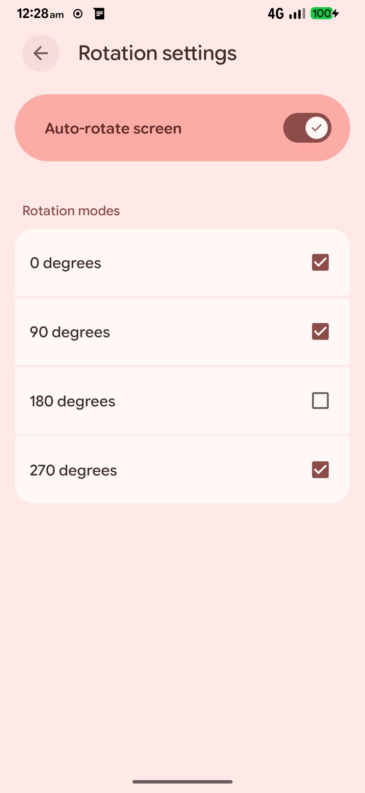
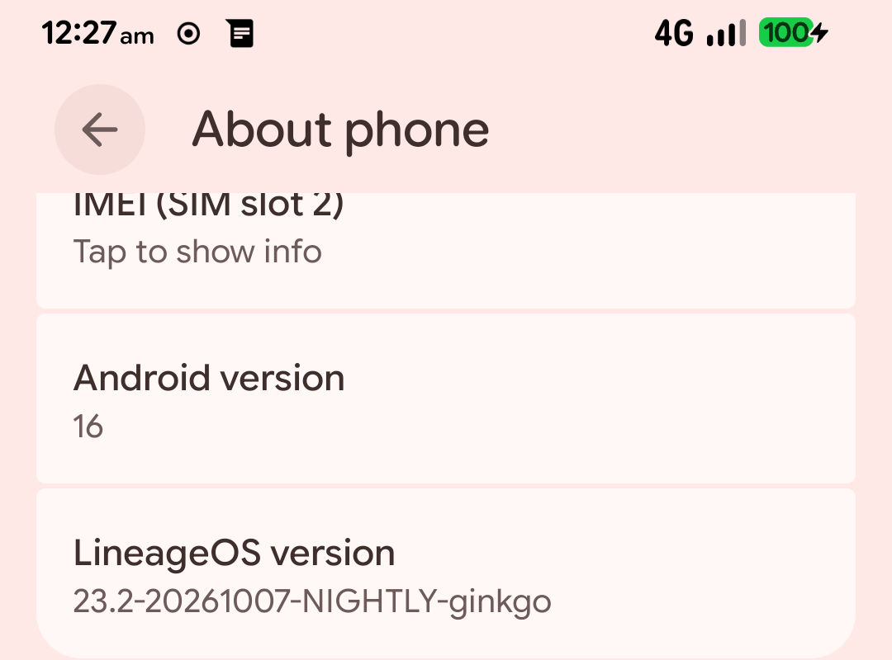

I have a soft spot for the Redmi Note 8. It is old, it is not fast, and the Snapdragon 665 is not winning any awards in 2026. But it is a perfectly good phone, and I was not ready to let it go.

A few days ago I managed to wipe its EFS and persist partitions. Not on purpose, obviously. One moment it was a working LineageOS phone, and the next it had no IMEI, no mobile service, and no working auto-rotate. I genuinely thought I had killed it.

This is the story of how I got it back.

## What actually broke

The phone was running LineageOS 23.2 on Android 16, with Magisk and an OrangeFox recovery. After the wipe, the damage looked like this:

- Both IMEIs were gone, so there was no cellular service at all.
- Auto-rotate was dead.
- `dumpsys sensorservice` said **"No Sensors on the device"**.
- WiFi and Bluetooth still worked, but with randomized MAC addresses.
- The camera still worked, which was honestly the only thing keeping me hopeful.

The important part is that two different partitions were involved, and they do different jobs.

**EFS is where your IMEI and modem identity live.** It sits in `efs1`, `efs2`, and `efsg`, along with the modemst and fsg partitions. If EFS is gone, your phone does not know who it is on the network.

**Persist is factory data.** It holds the sensor registry, WiFi and Bluetooth calibration, MAC addresses, and other bits of per-device information. It does not hold your IMEI. Writing a new persist image will not change your IMEI, but it can change your WiFi and Bluetooth identity and your sensor calibration.

I want to be very clear about that because a lot of forum posts mix the two up. I did not touch NV data. I did not write a random IMEI. I restored my own EFS backup and used a stock persist image for my exact model.

## Part 1: Getting the IMEI back

I had an OrangeFox backup from February 2025. I cannot tell you how relieved I was to see that folder. It had `efs1`, `efs2`, `efsc`, and `efsg`. Only `efs1`, `efs2`, and `efsg` were restored, because `efsc` was blank in both the backup and the live partition, so there was nothing to recover there.

The restore happened in OrangeFox with `dd` and a read-back check:

```sh
dd if=/sdcard/Fox/BACKUPS/<serial>/<date>/efs1.emmc.win of=/dev/block/by-name/efs1 bs=4096
dd if=/sdcard/Fox/BACKUPS/<serial>/<date>/efs2.emmc.win of=/dev/block/by-name/efs2 bs=4096
dd if=/sdcard/Fox/BACKUPS/<serial>/<date>/efsg.emmc.win of=/dev/block/by-name/efsg bs=4096
sync
```

Then I compared the partition hashes with the backup files:

```sh
sha256sum /dev/block/by-name/efs1
```

You cannot just read the IMEI out of an EFS image. The payload is encrypted, and the files start with `IMAGEFS1`, `IMAGEFS2`, and `IMAGEFSG` headers. The real test is whether the modem comes back and whether the phone reports the same identity as before.

Mine did. Both IMEI slots came back, both passed the Luhn check, and the `DEVICE_IDENTITY` hashes in the radio log matched the pre-wipe values exactly. The modem registered on Jio 4G LTE and mobile data started working again.

I let out a very long breath.

## Part 2: The sensors were still dead

The IMEI was back, but auto-rotate still did nothing. My first move was the obvious one: I turned the auto-rotate toggle off and on again. Nothing. I checked the setting value. It was already `1`. So the toggle was not the problem.

Then I ran:

```sh
adb shell dumpsys sensorservice
```

And got:

```text
No Sensors on the device
```

That is a weird sentence to read on a phone that definitely has sensors. The logcat output explained it:

```text
E sensors-hal: is_registry_up: registry_sensor unavailable even after '24.3secs' of serviceup(no of repeats:'80')
E sensors-hal: sensor_factory: registry sensor not ready, not trying to get sensors list
I sensors-hal: get_sensors_list: num_sensors=0
```

The sensor HAL was loading fine. The ADSP was online. The phone was not missing a driver. It was missing the **SSC registry sensor**, and that registry lives on the persist partition.

The vendor config made the path obvious:

```sh
adb shell cat /vendor/etc/sensors/sns_reg_config
```

```text
version=1
file=output=/mnt/vendor/persist/sensors/registry/registry
property=persist.vendor.sensors.enable.property=/mnt/vendor/persist/sensors/registry/file1
property=persist.vendor.sensors.enable.property1=/mnt/vendor/persist/sensors/registry/file2
```

Then I checked whether persist was actually mounted:

```sh
adb shell su -c 'mount | grep -i persist'
adb shell su -c 'sha256sum /dev/block/mmcblk0p69 /dev/block/mmcblk0p70'
```

There was no real persist mount. `/mnt/vendor/persist` was just a tmpfs mount point. And both `persist` and `persistbak` had the same all-zero SHA256. Not empty. Zeros.

So the chain was pretty simple once I saw it:

1. Persist was zeroed and never mounted.
2. `/mnt/vendor/persist/sensors/registry` did not exist.
3. The SSC never exposed a registry sensor.
4. The sensor HAL waited, gave up, and reported zero sensors.
5. Auto-rotate had nothing to listen to.

I had spent a stupid amount of time on the rotation toggle. The toggle was never the problem.

## Part 3: Fixing persist

The fix is the standard Xiaomi persist repair: write a stock `persist.img` from the matching fastboot ROM. That image contains the sensor registry and the factory calibration data the HAL is looking for.

I downloaded the EEA fastboot ROM for the Redmi Note 8, version `V12.5.12.0.RCOEUXM`. That matched the MIUI 12.5.12 EEA vendor that was already on the phone, which felt like the safest choice. I verified the MD5 before extracting anything.

Then I pulled out just the persist image:

```sh
tar -xzf ginkgo_eea_global_images_*.tgz \
  "ginkgo_eea_global_images_*/images/persist.img"
```

The image was 32 MiB and the partition is 64 MiB. That is normal. The ext4 filesystem only uses the first 32 MiB, and the rest of the partition stays zeroed. I checked the ext4 magic at offset `0x438` to make sure the file was not truncated or corrupted:

```sh
python -c "import struct; d=open('persist.img','rb').read(4096); print(hex(struct.unpack_from('<H', d, 0x438)[0]))"
```

It printed `0xef53`. Good.

### Back up first

I backed up both partitions before writing anything, even though they were already blank:

```sh
mkdir -p /sdcard/persist_backup
dd if=/dev/block/by-name/persist    of=/sdcard/persist_backup/persist.img    bs=4096
dd if=/dev/block/by-name/persistbak of=/sdcard/persist_backup/persistbak.img bs=4096
sync
sha256sum /sdcard/persist_backup/*.img
```

I know it feels silly to back up a partition that is all zeros. Do it anyway. It gives you a known baseline and it proves you are writing to the right block device.

### Write both partitions

`persistbak` is the backup copy of `persist`. Stock flash scripts often leave both entries empty in `rawprogram0.xml` so they do not overwrite factory data, which means the repair has to be done manually.

In OrangeFox, with `persist.img` pushed to `/tmp`:

```sh
mount | grep -i persist

dd if=/tmp/persist.img of=/dev/block/by-name/persist    bs=4096
dd if=/tmp/persist.img of=/dev/block/by-name/persistbak bs=4096
sync
```

Then I read back exactly the number of bytes I wrote and compared the hashes:

```sh
dd if=/dev/block/by-name/persist    bs=4096 count=8192 2>/dev/null | sha256sum
dd if=/dev/block/by-name/persistbak bs=4096 count=8192 2>/dev/null | sha256sum
sha256sum /tmp/persist.img
```

All three hashes matched. I checked them more than once. I am not ashamed of that.

## The payoff

I rebooted, waited for LineageOS to come up, and checked the mount:

```sh
adb shell mount | grep -i persist
```

This time it showed the real partition:

```text
/dev/block/mmcblk0p69 on /mnt/vendor/persist type ext4 (rw,seclabel,nosuid,nodev,noatime,data=ordered)
```

Then I ran `dumpsys sensorservice` again. It listed **29 hardware sensors, 29 running**. The BMI160 accelerometer, the gyroscope, the rotation vector, the magnetometer, the ambient light sensor, the proximity sensor, all of it. The accelerometer was actually streaming values. I tilted the phone and watched the numbers move.

Auto-rotate worked. I sat there rotating the phone like an idiot for a minute.



*The toggle was on the whole time. The phone just had no sensors to feed it.*

## What I checked after

I did not want to celebrate too early, so I went through the rest of the phone:

- The IMEI was still intact. The `DEVICE_IDENTITY` hashes in the radio log matched the pre-repair values.
- The modem was `IN_SERVICE` on LTE, with voice and mobile data working.
- WiFi and Bluetooth still worked.
- The camera still worked.
- The fingerprint sensor was detected and the HAL was up.
- The persist registry files were present with their stock timestamps.

The phone was back.



*Still running LineageOS 23.2 on Android 16, after all of that.*

## What I would tell anyone else

A few things I learned the hard way:

- **Back up EFS and persist before you touch anything.** I got lucky because I had an EFS backup from months earlier. If I had not, this story would be very different.
- **Do not write a random or "found" IMEI.** Restore your own EFS backup. IMEI modification is illegal in a lot of places and it usually makes things worse.
- **Match the persist image to your exact model.** The Redmi Note 8 is `ginkgo`. The Redmi Note 8T is `willow`. They are not the same phone. Use the stock image for your model, and ideally for your vendor version.
- **Verify the block device by name, not by memory.** Run `ls -l /dev/block/by-name | grep -E 'persist|efs'` before any `dd`. One wrong path can ruin your day.
- **Do not skip the read-back.** Writing is not the same as writing correctly. Compare the SHA256 of the image and both partitions.
- **Keep a rollback.** In my case the original persist was all zeros, so rolling back just means writing zeros again. If your original partition has data, keep a copy of it somewhere safe.

And if you are stuck with `No Sensors on the device` and `registry_sensor unavailable` in the logs, check whether persist is actually mounted before you touch the rotation settings. That was the whole mystery for me.

The phone is not factory-perfect anymore. The persist image is stock calibration, not my unit's original calibration, and I cannot confirm the Widevine level without a DRM info app. But the IMEI is mine, the NV data was never touched, and the phone does everything I need it to do.

It is old, it is a little beat up, and it still works. That is all I wanted.
