# UX Feature Proposals & Implementation Plan

> **Status:** Implemented  
> **Target Date:** November 2026  
> **Scope:** High-utility micro-features to enhance reader engagement, jargon accessibility, and site personality.

---

## 1. Overview & Vision

This plan details three lightweight, high-delight features designed to enhance user experience across **theonlyasdk.github.io**. Rather than adding unnecessary weight or superficial animations, each feature directly solves a friction point for visitors reading technical guides (Android flashing, Linux optimization) or exploring interactive toys in the Goodies & Collections sections.

```mermaid
flowchart TD
    subgraph Feature1 ["1. 🎲 Discovery Dice"]
        D["Topbar / Sidebar Dice Button"] -->|"Click + 360° Spin"| R["Select Random Article or Goodie"]
        R -->|"Exclude Current URL"| P["Smooth Route Navigation"]
    end

    subgraph Feature2 ["2. 📚 Tech Jargon Hover Cards"]
        G["_data/glossary.yml"] --> S["Post Body Scanner (#post-wrapper)"]
        S --> W["Wrap First Mention in <dfn>"]
        W -->|"Desktop Hover / Mobile Tap"| H["Wikipedia-Style Floating Card"]
    end

    subgraph Feature3 ["3. 📍 Local Time & Status Pill"]
        T["Intl.DateTimeFormat (Asia/Kolkata)"] --> M["Time-of-Day Status Matrix"]
        M --> B["Live Pill under Sidebar Avatar"]
    end
```



---

## 2. Feature Specifications

### Feature 1: 🎲 "I'm Feeling Curious" Discovery Dice

#### Problem
The site hosts a diverse collection of technical write-ups and interactive experiments (Cellular Automata, Fractal Viewer, Sorting Visualizer, Procedural Terrain, etc.). First-time visitors landing from search engines often read a single article and leave without discovering the creative canvas experiments.

#### UX & Micro-Interactions
* **Placement:**
  - **Desktop:** Directly beside the search trigger in `_includes/topbar.html` or next to the mode toggle in `_includes/sidebar.html`.
  - **Mobile:** Accessible in the top navigation row.
* **Interaction:**
  - Hovering displays a tooltip: *"I'm feeling curious (Random post or toy)"*.
  - Clicking triggers an extruded spring-physics rotation (`transform: rotate(360deg) scale(1.1)` for 350ms).
  - Selects a random URL from the post/goodie registry, ensuring it never navigates to the currently viewed URL.
  - Optional keyboard shortcut: pressing <kbd>R</kbd> (when no text input is focused) rolls the dice.

#### Implementation Details
* **Data Generation:** Liquid collects all published posts and goodies into a compact JSON array:
  ```json
  [
    {"title": "Redmi Note 8 Ginkgo Unbrick Guide", "url": "/posts/redmi-note-8-ginkgo-custom-rom-unbrick-guide/"},
    {"title": "Fractal Viewer", "url": "/goodies/fractal-viewer/"},
    {"title": "Cellular Automaton", "url": "/goodies/cellular-automaton/"}
  ]
  ```
* **Performance:** Inline JSON payload is < 3 KB; zero third-party libraries.

---

### Feature 2: 📚 Wikipedia-Style Hover Cards for Tech Jargon

#### Problem
Guides dealing with Android partition schemes and Linux system internals are packed with dense terminology (`EDL`, `Fastboot`, `TWRP`, `vbmeta`, `DTBO`, `payload.bin`, `CachyOS`, `SP Flash Tool`). Beginners and intermediate users frequently have to open separate search tabs to check what these terms do, breaking their concentration.

#### UX & Micro-Interactions
* **Appearance:**
  - Jargon terms receive a subtle dotted underline (`border-bottom: 1.5px dotted var(--link-underline-color)`).
  - Hover cursor is set to `help`.
* **Hover Card Preview:**
  - On hover (desktop) or tap (mobile), a clean floating popover card appears anchored to the keyword.
  - **Card Header:** Term Title + Category Badge (e.g., `Qualcomm / Android`, `Security / Bootloader`).
  - **Card Content:** Clear 1–2 sentence plain-English explanation of its purpose and practical function.
  - **Card Footer:** Optional external reference link (e.g., Wikipedia or official docs) with an external-link icon.
* **Touch & Responsive Behavior:**
  - On mobile devices, tapping the term triggers the card modal/popover. Tapping outside or scrolling dismisses it.
  - Viewport bounds detection prevents cards from clipping off the left, right, or top edges of the screen.
* **Reading Guardrail:**
  - Scans only `.content` within post layouts.
  - Automatically wraps only the **first occurrence** of each term per section so the article does not feel over-annotated.
  - Skips text within headings (`<h1>`–`<h6>`), existing links (`<a>`), and code blocks (`<pre>`, `<code>`).

#### Data Structure (`_data/glossary.yml`)
```yaml
edl:
  term: "EDL Mode"
  category: "Qualcomm / Android"
  summary: "Emergency Download Mode. A low-level ROM-resident bootloader state in Qualcomm chips used for recovery and flashing when primary bootloaders are damaged."
  url: "https://en.wikipedia.org/wiki/Qualcomm_EDL_mode"

vbmeta:
  term: "vbmeta"
  category: "Android Partition"
  summary: "Verified Boot Metadata partition. Contains cryptographic signatures and hashes to enforce Android Verified Boot (AVB 2.0) partition integrity."

dtbo:
  term: "DTBO"
  category: "Linux / Kernel"
  summary: "Device Tree Blob Overlay. Houses hardware-specific device tree modifications applied over the base kernel device tree at boot time."
```

---

### Feature 3: 📍 Sidebar "Local Time & Status" Pill

#### Problem
Technical portfolios can sometimes feel like static documentation. A live indicator creates a sense of presence and adds human warmth.

#### UX & Micro-Interactions
* **Placement:**
  - Inside `_includes/sidebar.html`, positioned below `.site-subtitle` in `.profile-wrapper` and above the main tab navigation.
* **Visual Styling:**
  - Sleek capsule/pill container styled with hairline border and subtle backdrop blur matching the site's card theme.
  - Left indicator: Soft glowing status dot (emerald green during waking/working hours, indigo/violet during late night).
  - Clock readout: Formatted live in IST (`Asia/Kolkata` as configured in `_config.yml`):
    `10:45 PM IST`
  - Dynamic status flavor text:
    - 🌅 `07:00 – 12:00`: *Morning coffee & building*
    - ⚡ `12:00 – 18:00`: *Hacking & tinkering*
    - ☕ `18:00 – 23:00`: *Evening side-projects*
    - 🌙 `23:00 – 07:00`: *Asleep / dreaming in C++*
* **Efficiency:**
  - Driven by native `Intl.DateTimeFormat` with a 30-second interval timer.
  - Suspends timer when tab is inactive (`document.hidden`) to preserve battery life.

---

## 3. Repository & Architectural Constraints

All implementations must strictly follow the rules documented in [AGENTS.md](file:///c:/Users/User/Documents/GitHub/theonlyasdk.github.io/AGENTS.md):

1. **Inline JavaScript & Compression Rule:**
   - **Never** use single-line comments (`// ...`) inside template `<script>` tags (`_includes`, `_layouts`, `_tabs`, `_posts`).
   - Use block comments (`/* ... */`) exclusively.
   - Every statement must end with an explicit semicolon (`;`) so minification via `_layouts/compress.html` does not cause syntax errors.
   - Always run the validator prior to finalizing:
     ```bash
     node tools/check_inline_scripts.js
     ```

2. **Styling & CSS Architecture:**
   - Store styles in dedicated Sass partials:
     - `_sass/components/_dice.scss`
     - `_sass/components/_hovercard.scss`
     - `_sass/components/_sidebar-pill.scss`
   - Forward all partials through `_sass/components/_index.scss` or `_sass/main.scss`.
   - Use CSS variables for theme compatibility (`--card-bg`, `--text-color`, `--border-color`, `--sidebar-bg`).

3. **PWA & Cache Invalidation:**
   - PWA caching remains disabled (`pwa.cache.enabled: false`) ensuring all new assets update immediately.

---

## 4. Execution Phases

| Phase | Milestone | Deliverables | Status |
| :--- | :--- | :--- | :--- |
| **Phase 1** | **Discovery Dice (🎲)** | Topbar/Sidebar button, random selection logic, roll animation, full-site URL list | Completed |
| **Phase 2** | **Jargon Hover Cards** | `_data/glossary.yml`, post DOM text scanner, hover card component with arrow and bounds check | Completed |
| **Phase 3** | **Sidebar Time & Status Pill** | IST clock logic, time-of-day status map, pulsing indicator, responsive sidebar styling | Completed |
| **Phase 4** | **Verification & Auditing** | `node tools/check_inline_scripts.js`, light/dark mode contrast check, mobile viewport testing | Completed (703 inline scripts verified) |
